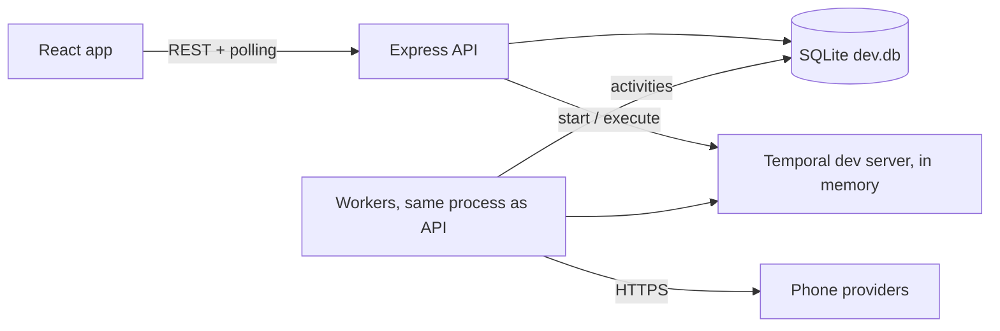
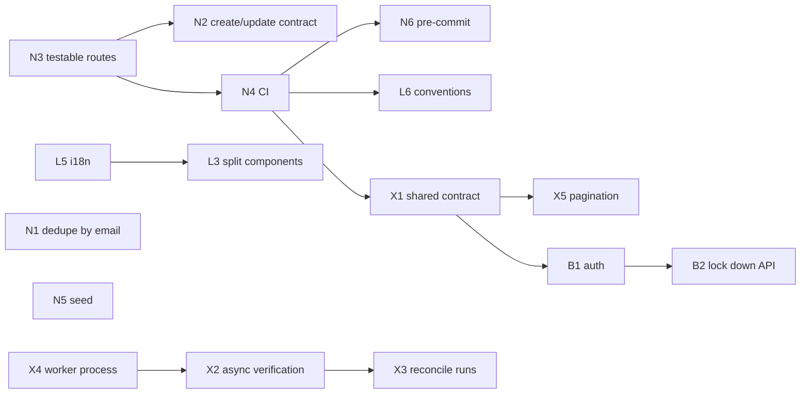

# TinyEnginy: codebase improvements and technical roadmap

| | |
|---|---|
| **Type** | Technical roadmap |
| **Status** | Proposed |
| **Date** | 2026-11-21 |
| **Scope** | `backend/` (Express, Prisma, Temporal) and `frontend/` (React, TanStack Query) |
| **Related** | Tickets 01–04 in `.scratch/take-home/issues/`, ADRs 0001–0010 in `.scratch/take-home/adr/` |

## Summary

The four take-home tickets are done, and both apps now build with no errors. Backend: 233 tests. Frontend: 128 tests. The remaining risk is in three areas:

1. **Data quality.** The CSV import still saves duplicate leads, and two lead endpoints write wrong data.
2. **Engineering safety net.** There is no CI, no linter that runs, and no route tests. The frontend types are a manual copy of the backend.
3. **Production readiness.** There is no auth, the API allows any origin, SQLite is the database, and Temporal keeps its state in memory.

Recommendation: do the **Now** items first. They are small, they fix wrong data that users can see, and they make every later change safer. Do the **Before production** track before any real customer data goes into the app.

## Current state

What works well, and must stay:

- **Temporal for slow, unreliable work.** Bounded retries, deterministic workflow IDs, and one task queue per provider (ADRs 0003, 0009).
- **Pure, tested domain helpers.** Country codes, years, LinkedIn URLs, template fields, and provider adapters are plain functions with tests.
- **One rule for invalid optional data.** Drop the value, warn, and let the backend do the final check (ADR 0002).

## Findings

Severity: **High** means wrong data or a security gap today. **Medium** means a risk that grows with use. **Low** means a cost to developer speed.

### Data correctness

| # | Finding | Evidence | Severity |
|---|---|---|---|
| D1 | The bulk import saves duplicates from the same CSV. It checks only against leads already in the database. | `docs/leads-with-errors.csv` has Curtis Monson twice. The database now has `curtismonson80@gmail.com` two times. The preview counts "Duplicates in CSV" but imports them anyway. | High |
| D2 | The duplicate check uses first and last name, not email. Two people with the same name block each other, and one email can exist many times. | `rodriguezbrian@smith.net` is stored for both "Iñaki Álvarez" and "Steven Hernandez". The schema has no unique constraint. | High |
| D3 | `PATCH /leads/:id` writes the text `"undefined"` when the body has no `name`. It reads `name`, not `firstName`, and calls `String()` on the value. | `backend/src/index.ts`, the PATCH route. | High |
| D4 | The frontend `update` entry uses `PUT`, but the backend route is `PATCH`. Any call returns 404. | `frontend/src/api/modules/leads.ts`. No screen uses it yet, so it has not failed in front of a user. | Medium |
| D5 | `POST /leads` reads `name` instead of `firstName`, and it ignores every optional field. | `backend/src/index.ts`, the create route. | Medium |
| D6 | A failed email check keeps the old ✅ or ❌, so the table can show a result that the latest check did not confirm. | ADR 0003, consequences. | Medium |
| D7 | A lead stays `running` after a Temporal restart, because the dev server keeps no history. | ADR 0007, consequences. | Medium |

### Engineering safety net

| # | Finding | Evidence | Severity |
|---|---|---|---|
| E1 | No CI. Tests and builds run only when someone runs them by hand. | No `.github/` folder. | High |
| E2 | The frontend linter does not run. ESLint 9 needs a flat config, and the app has only `.eslintrc.cjs`. | Known failure in `CLAUDE.md`. | Medium |
| E3 | The routes have no tests. Importing `index.ts` starts the server and the workers. | Tickets 03 and 04 had to leave route checks for manual tests. | Medium |
| E4 | The frontend API types are a manual copy of the backend. Each lead field change touches six places. | `CLAUDE.md`, "Change a lead field". | Medium |
| E5 | The validation rules exist twice: country codes, years, and LinkedIn URLs have one copy in each app. | ADRs 0001, 0002. Each copy has a comment that names the other. | Medium |
| E6 | Request bodies are not checked at the API boundary. Routes destructure `req.body` and cast. | `backend/src/index.ts`. The bulk import error type is `lead: any`. | Medium |
| E7 | `dev.db` is a committed binary file. Two branches with migrations cannot merge it, and test data leaks into commits. | Tickets 01, 03, and 04 each had to restore it by hand. | Low |
| E8 | Several existing files do not follow the Prettier config, so each change must format by hand to keep the diff small. | `LeadsList.tsx`, others. | Low |

### Production readiness

| # | Finding | Evidence | Severity |
|---|---|---|---|
| P1 | No authentication or authorization. Any caller can read, change, or delete all leads. | No auth middleware. | High |
| P2 | CORS allows any origin (`*`). | `backend/src/index.ts`. | High |
| P3 | The workers run in the API process. A worker error ends the API with `process.exit(1)`, and API and worker load cannot scale apart. | `backend/src/index.ts`, the last lines. | Medium |
| P4 | SQLite and an in-memory Temporal server. Neither supports more than one instance or survives a restart with its data. | `schema.prisma`, `mise.toml`. | Medium |
| P5 | `GET /leads` returns every lead with no pagination. The table renders all rows. | `backend/src/index.ts`, `LeadsList.tsx`. | Medium |
| P6 | Logs are plain `console.log`. There is no health check and no request ID. | `backend/src/index.ts`. | Low |
| P7 | Message generation updates leads one at a time in the request. A large selection blocks the request. | The `generate-messages` route. | Low |

## Minor improvements

These are code-level conventions. Each one is small alone, but together they make the code easier to read, check, and translate. Apply them to new and changed code first, then fix existing code in focused passes.

| # | Improvement | Evidence today | Recommendation |
|---|---|---|---|
| M1 | **Use `assert` for general validation** | `backend/src/index.ts` repeats the guard `if (...) return res.status(400).json(...)` 11 times. | Add one typed helper, `assert(condition, message): asserts condition`, that throws a `ValidationError`. One Express error middleware turns it into a 400. TypeScript then narrows the value after each check. Use Zod (X1) for body shapes, and `assert` for the other rules. |
| M2 | **No magic strings or magic values** | `app.listen(4000)`, and the log line repeats `4000`. HTTP codes `400`, `404`, and `500` are literals in each route. Toast texts and IDs are inline. The Temporal values are already constants (`TEMPORAL_TASK_QUEUE`). | Give each value a named constant: the port from the environment, HTTP status constants, and status values from one `as const` object. Turn on a lint rule for magic numbers, so the rule stays applied. |
| M3 | **No ternary strings** | 18 ternaries choose between two strings, for example `Lead{count !== 1 ? 's' : ''}` in `MessageTemplateModal.tsx`, and the ❓/✅/❌ choice in `LeadsList.tsx`. | Use a lookup map for a fixed set of states, for example `Record<EmailStatus, Icon>`. Use the plural rules of i18n (M5) for counts. A ternary hides a state that has no case, and it cannot be translated. |
| M4 | **Stop versioning `frontend/.env`** | `frontend/.env` is in git. Today it holds only `VITE_API_URL`, which is not a secret. But a versioned env file makes it easy to commit a real secret later. Every `VITE_` value is also public in the bundle. | Remove it from git and add `.env` to `frontend/.gitignore`. Add `frontend/.env.example` with the names only, as the backend has. Never put a secret in a `VITE_` variable. Add a secret scan to the pre-commit hook (M6). |
| M5 | **Internationalization (i18n)** | All UI text is hard-coded in the components, for example "Please select a CSV file" and "Failed to delete leads. Please try again.". Backend error messages are English text that the UI shows as it is. | Use `react-i18next` with one JSON file for each language (`locales/en.json`, `locales/es.json`). Components use keys, for example `t('import.errors.notCsv')`. ICU plurals replace the count ternaries (M3). The backend returns a stable error code with its message, so the UI translates the code. |
| M6 | **Pre-commit hooks** | No hook runs before a commit. Formatting, lint, and secrets depend on each developer. | Add Lefthook (or Husky with lint-staged). On staged files: format, lint, and a secret scan with Gitleaks. Keep the hook fast. The full tests and builds stay in CI (N4). |
| M7 | **Oxlint and Oxfmt instead of ESLint and Prettier** | ESLint does not run (E2), and some files do not follow the Prettier config (E8). | Replace both with Oxlint and Oxfmt. **Why: speed, at a low migration cost.** • **Much faster.** In the Oxc benchmarks, Oxlint is 50–100x faster than ESLint, and Oxfmt is about 30x faster than Prettier. The pre-commit hook (M6) can then lint and format each commit with no noticeable wait, and CI (N4) gets shorter. • **The change is not painful.** Oxfmt is compatible with Prettier, and `oxfmt --migrate=prettier` converts the config. Our two Prettier configs use only five plain options and no plugins, so they convert as they are. Oxlint uses the ESLint rule names and has the TypeScript and React rules built in. Steps: run the Oxfmt migration in each app. Write `.oxlintrc.json` by hand, because `@oxlint/migrate` reads only an ESLint flat config and the app has a legacy `.eslintrc.cjs`. Format the full repo in one commit, and add that commit to `.git-blame-ignore-revs`. |

## Roadmap

Effort: **S** is up to 1 day, **M** is 2–4 days, **L** is 1–2 weeks.

### Now: fix wrong data and add the safety net

| Item | Fixes | Effort | Outcome |
|---|---|---|---|
| **N1. Deduplicate the import by email** | D1, D2 | S | The import skips a second row with the same email, in the CSV and in the database. The preview and the backend agree on the duplicate count. A unique index on `email` stops new duplicates. A migration reports the duplicates that exist now, before it adds the index. |
| **N2. Fix the lead create and update contract** | D3, D4, D5 | S | Both routes read `firstName`. PATCH changes only the fields that are in the body. The frontend uses `PATCH`. Route tests cover each case. |
| **N3. Make routes testable** | E3 | S | Split `createApp()` from `listen()` and from the worker start. Add route tests with Supertest for the bulk import, verify-emails, and enrich-phones. |
| **N4. Add CI with Oxlint and Oxfmt** | E1, E2, E8, M7 | S | Replace ESLint and Prettier with Oxlint and Oxfmt, and format the repo in one commit. A GitHub Actions job runs lint, the format check, `pnpm vitest run`, and `pnpm build` in both apps on each pull request. |
| **N5. Replace the committed database with a seed** | E7 | S | `prisma db seed` creates the 25 seed leads. Git ignores `dev.db`. Migrations merge as text. |
| **N6. Pre-commit hooks and env hygiene** | M4, M6 | S | Lefthook runs Oxfmt, Oxlint, and Gitleaks on staged files. `frontend/.env` leaves git, and `frontend/.env.example` takes its place. |

### Next: remove duplication and finish the async pattern

| Item | Fixes | Effort | Outcome |
|---|---|---|---|
| **X1. One API contract for both apps** | E4, E5, E6 | M | Make a pnpm workspace with a `shared` package. It holds Zod schemas for each request and response, and the validators from ADRs 0001 and 0002. The backend checks each body with them, and the frontend types come from them. A lead field change touches the schema, the shared package, and the UI. |
| **X2. Async email verification** | D6 | M | Move email verification to the pattern of ADR 0007: a stored status, `workflow.start`, and polling. Supersede ADR 0003. A failed check shows as "could not verify", not as an old result. |
| **X3. Reconcile stuck runs** | D7 | S | A scheduled job finds leads that are `running` with no open workflow and sets them to `failed`. The user can start them again. |
| **X4. Run workers as their own process** | P3 | S | `pnpm worker` starts the workers. The API no longer exits when a worker fails. Both run from `mise run dev`. |
| **X5. Paginate the leads list** | P5 | M | `GET /leads` takes a cursor and a page size. Filtering and sorting run on the server. Polling refetches only the visible page. |
| **X6. Prove the provider rate limits** | ADR 0009 | S | An integration test against a local Temporal server shows that `maxTaskQueueActivitiesPerSecond` holds calls to the limit. Add a metric for calls, failures, and latency for each provider. |

### Before production: security and infrastructure

| Item | Fixes | Effort | Outcome |
|---|---|---|---|
| **B1. Authentication and workspaces** | P1 | L | Users sign in. Each lead belongs to a workspace, and each query filters by it. |
| **B2. Lock down the API** | P2 | S | CORS allows only the app origin. Add request size limits and a rate limit for each user. |
| **B3. Postgres and a persistent Temporal** | P4 | M | Prisma uses Postgres. Temporal runs as a cluster or Temporal Cloud. Secrets come from a secret manager, not from `.env`. |
| **B4. Observability** | P6 | M | Structured JSON logs with a request ID, `GET /health`, error tracking, and Temporal metrics on a dashboard. |

### Later: product depth

| Item | Why | Effort |
|---|---|---|
| **L1. One phone format (E.164)** | Phones from CSV and from providers are in different formats (ADR 0006). Use `libphonenumber-js` with the lead country, then backfill. | M |
| **L2. Message preview and saved templates** | Users see the result for one lead before they generate for all. Templates are reused. Generation moves to a workflow (P7). | M |
| **L3. Split the large components** | `LeadsList.tsx` has 459 lines, and `CsvImportModal.tsx` has 411. Extract the table, the action menu, and the toasts into small, tested parts. | M |
| **L4. Edit the new fields in the UI** | Phone, years, and LinkedIn can only come from a CSV or a provider today. | S |
| **L5. Internationalization** | Move all UI text to locale JSON files, and return error codes from the API (M5). Start with English, then add a second language to prove the setup. Do it before L3, so the split components use keys from the start. | M |
| **L6. Apply the code conventions** | Add the `assert` helper and the error middleware (M1). Replace magic values (M2) and ternary strings (M3). Turn on lint rules, so new code follows them. | S |

## Sequencing

- N1, N5, and X4 have no blockers, so they can start in parallel.
- Do N3 before N2, so the contract fix lands with route tests.
- Do X1 before auth (B1). Every route gets a checked body first, and auth then adds one field to each schema.
- Do N4 before N6 and L6. The hook and the lint rules use the new tools.
- Do L5 before L3. The split components then use translation keys from the start.

## Risks and open questions

| Topic | Note |
|---|---|
| Existing duplicates | N1 adds a unique index. The migration fails while duplicates exist. Decide with the product owner which row to keep: the oldest, the most complete, or a manual merge. |
| "Years at company" vs "years in role" | The CSV column is `yearsInRole`. The import reads it as years at the current company. Confirm with the product owner that the two are the same for our users. |
| Provider data quality | The providers return random phones for the same input. Before we pay for them in production, measure the hit rate and the accuracy for each provider on a known sample. |
| Shared package (X1) | A workspace changes how both apps build and test. Do it in one focused change, with CI (N4) in place first. |
| Oxfmt output (N4) | Oxfmt aims to match Prettier, but small output differences are possible. Check the diff of the one-time format commit before you merge it. |
